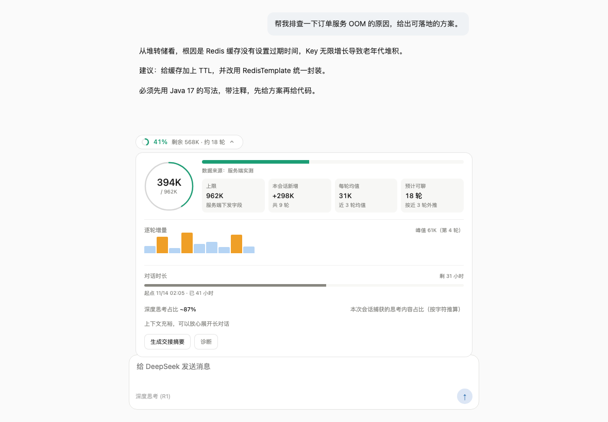

# DeepSeek 上下文仪表

在 chat.deepseek.com 的输入框上方常驻一条细带，实时显示当前对话的**真实**上下文用量、剩余空间和预计还能聊几轮。



> 非官方扩展，与深度求索无隶属关系。全部数据处理在本地完成。

---

## 为什么需要它

DeepSeek 网页版**从不告诉你还剩多少上下文**。你只能等到某一轮突然弹出「长度限制已达到，请开启新对话」——而此时前面的对话已经无法继续，只能手工搬一份摘要到新会话。

2026 年 11 月起规则又多两条：App 端开始限制 **72 小时长对话**、**单会话约 14.8 万字**。这些都是有明确阈值的限制，但官方一个数字都没公布。

这个扩展做的事很简单：**把服务端已经算好的那个数字，显示给你看。**

---

## 功能

**上下文**

- 真实用量：从流式响应里解析 `accumulated_token_usage`，不是字符估算
- 剩余空间与百分比，随每条回复实时跳动
- **预计还能聊几轮**：按最近 3 轮的平均增量外推
- 逐轮增量柱状图，一眼看出哪几轮最吃上下文
- 深度思考占比：推理内容通常比正文多吃十倍 token，这部分以前完全不可见

**时间**

- 从会话创建时间起算的对话时长
- 对着 72 小时限制画进度条，80% 琥珀、95% 深红
- 超过 90% 时自动把建议切换为「尽快交接」

**交接**

- 一键生成摘要：【任务】【已确认】【待办】【约束】四段
- 纯本地规则抽取，不调模型、不发消息
- 生成后可编辑再复制；有「复制并开新对话」，但**绝不代替你发送**

---

## 安装

1. 下载或克隆本仓库
2. 打开 Chrome，地址栏输入 `chrome://extensions`
3. 右上角开启「开发者模式」
4. 点「加载已解压的扩展程序」，选择本目录

然后打开 https://chat.deepseek.com，进入任意对话，输入框上方就会出现那条带子。

> 需要 Chrome 111 及以上（依赖 content script 的 `world: "MAIN"`）。

---

## 怎么读这个界面

折叠态：

```
◔ 62% · 剩余 361K · 约 18 轮        ⌄
```

点开是详情面板，再点收起。

**颜色**：低于 60% 中性，60% 起转蓝，85% 琥珀，95% 红，被拦截深红。

**数据可信度**，三种标记不能混：

| 标记 | 含义 |
|---|---|
| 实心数字 | 服务端实测 |
| `~` 前缀 | 本地估算，可能偏差 |
| 时钟图标 | 上次已知值，本轮还没拿到 |

拿不到真值时，宁可标「未知」，也不把估算伪装成精确值。

---

## 隐私

- **只读**：只解析页面**已经收到**的响应，不修改、不重放、不伪造任何请求
- **不落盘正文**：对话文本仅在内存中过一遍用于生成摘要，存下来的只有计数
- **不碰凭证**：不读取 cookie 与登录态
- **无服务器、无遥测**：没有任何外部请求
- **权限最小**：只有 `storage` 和一个 host 权限，不需要 `webRequest`

---

## 已知限制

**1. 分母（也就是「100%」）不是官方数字**

DeepSeek 只在公告里说「1M 上下文」，但那是模型窗口，不是你能用满的量。

| 数值 | 来源 | 性质 |
|---|---|---|
| 1,000,000 | 官方公告 | 模型窗口，非可用上限 |
| 962,000 | 第三方实测拦截线 | 非官方 |
| 你的实测值 | 被拦截时自动记录 | 最可信 |

扩展默认用 962,000，界面标注「经验值（未校准）」。一旦你被「长度限制」拦过，会自动切到实测值并改标注。**在那之前它确实是个估计，我不会假装精确。**

**2. 老对话的正文拿不到**

打开已存在的长对话时，服务端只返回增量（`cache_control: MERGE`），历史正文不下发。所以交接摘要只能覆盖「本次会话开始后」捕获到的消息，面板会标出条数。

**3. 只支持 chat.deepseek.com**

不做多平台适配，也不覆盖 API 用户。

---

## 开发

```bash
# 解析器回归测试（13 项）
node test/parser.test.js

# 本地预览：不装扩展也能看界面
open test/preview.html
```

预览页参数：

| 参数 | 作用 |
|---|---|
| `?expand=1` | 直接展开面板 |
| `?digest=1` | 打开摘要弹窗 |
| `?diag=1` | 打开诊断弹窗 |
| `?p=88` | 模拟到 88% |
| `?age=70` | 模拟对话已开 70 小时 |
| `?turns=8` | 模拟 8 轮增量 |

```
deepseek-context-hud/
├─ manifest.json
├─ src/
│  ├─ main-world.js     页面上下文：接管 fetch/XHR、解析 SSE、读接口
│  └─ content.js        UI：Shadow DOM 挂载、状态、摘要生成
├─ icons/
├─ docs/
│  ├─ TECHNICAL.md      技术细节与逆向记录
│  └─ screenshot.png
└─ test/
   ├─ preview.html      本地预览（假数据）
   └─ parser.test.js    解析器回测
```

技术细节、接口结构、以及踩过的坑，见 [docs/TECHNICAL.md](docs/TECHNICAL.md)。

---

## License

MIT
